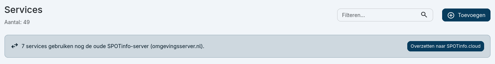
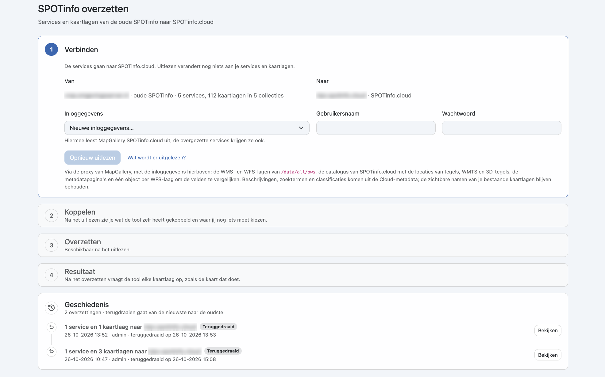
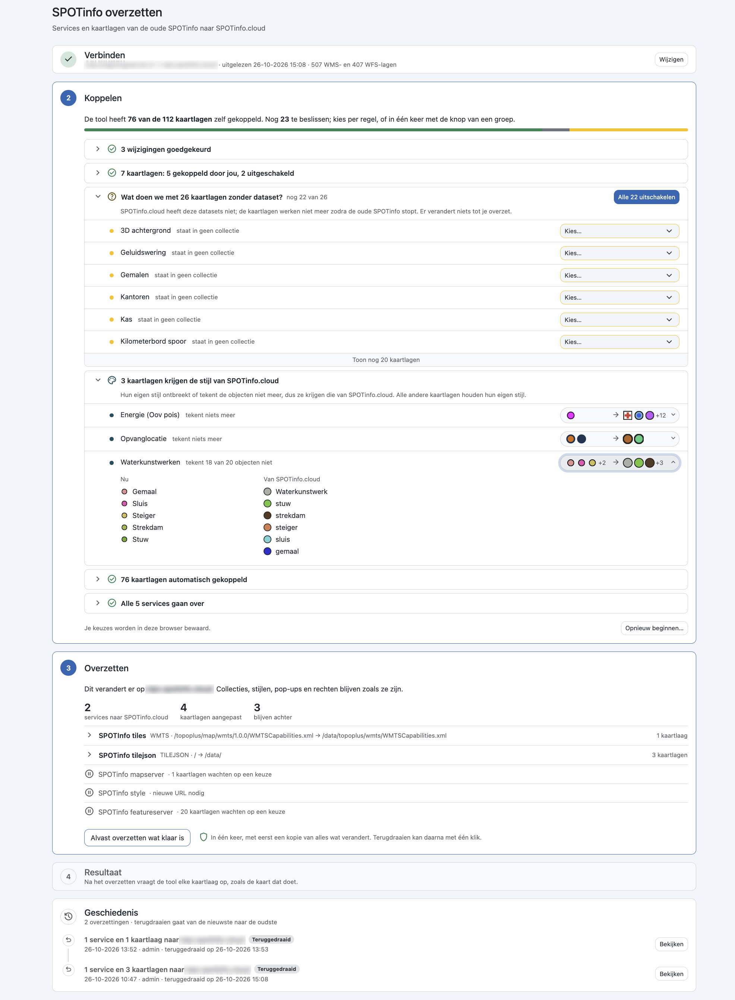

Met **SPOTinfo overzetten** zet je de services en kaartlagen die nog naar de oude SPOTinfo-server
(_omgevingsserver.nl_) verwijzen over naar **SPOTinfo.cloud**. De tool leest beide kanten uit, koppelt zoveel mogelijk
kaartlagen zelf en laat je alleen kiezen waar dat nodig is. Pas bij het overzetten verandert er iets in MapGallery.

!!! note "Tijdelijke functie"
    Deze tool is er alleen zolang de overstap naar SPOTinfo.cloud loopt. Na de overstap verdwijnt hij uit de
    beheeromgeving.

### Navigatie

1. Klik op het **instellingen-icoon** () rechtsboven in de header.
2. Kies in het menu **Opties** voor **SPOTinfo overzetten**.

Gebruiken nog services de oude SPOTinfo-server, dan staat er bovenaan de lijst met [**Services**](../../services/) een
melding met het aantal. Met de knop **Overzetten naar SPOTinfo.cloud** open je de tool ook.

## Werkwijze

De tool bestaat uit vier stappen, die je van boven naar beneden doorloopt. Een stap die klaar is, klapt in tot één
regel met een samenvatting.

### 1. Verbinden

Bij **Van** staat de oude SPOTinfo-server, met het aantal services, kaartlagen en collecties dat ervan gebruikmaakt. Bij
**Naar** staat de SPOTinfo.cloud-omgeving waar de services naartoe gaan.

1. Kies bij **Inloggegevens** bestaande inloggegevens, of kies **Nieuwe inloggegevens...** en vul **Gebruikersnaam**
   en **Wachtwoord** in. MapGallery leest hiermee SPOTinfo.cloud uit; de overgezette services krijgen dezelfde
   inloggegevens.
2. Klik op **Uitlezen** (of **Opnieuw uitlezen**).

Uitlezen verandert nog niets aan je services en kaartlagen. Via de proxy van MapGallery haalt de tool op:

* de WMS- en WFS-lagen van `/data/all/ows`;
* de catalogus van SPOTinfo.cloud, met de locaties van tegels, WMTS en 3D-tegels;
* de metadatapagina's;
* één object per WFS-laag, om de velden van oud en nieuw te vergelijken.

Beschrijvingen, zoektermen en classificaties komen uit de metadata van SPOTinfo.cloud. De zichtbare namen van je
bestaande kaartlagen blijven behouden.

Na het uitlezen toont stap 1 de servers, het tijdstip en het aantal gevonden WMS- en WFS-lagen. Met **Wijzigen** pas je
de verbinding aan en lees je opnieuw uit.

### 2. Koppelen

Hier zie je wat de tool zelf heeft gekoppeld en waar jij nog iets moet kiezen. Bovenaan staat hoeveel kaartlagen al
gekoppeld zijn en hoeveel er nog op een beslissing wachten; de balk laat dezelfde verhouding zien.

De kaartlagen staan in groepen. Groepen met een vinkje (✓) zijn afgehandeld; groepen met een vraagteken wachten op jou.
Klik op een groep om hem open of dicht te klappen.

| Groep                                  | Wat het betekent                                                                                                                                                                                                                                                                                  |
|----------------------------------------|---------------------------------------------------------------------------------------------------------------------------------------------------------------------------------------------------------------------------------------------------------------------------------------------------|
| **Automatisch gekoppeld**                | Kaartlagen die de tool zelf aan een dataset in SPOTinfo.cloud heeft gekoppeld. Hier hoef je niets te doen.                                                                                                                                                                                        |
| **Kaartlagen zonder dataset**            | SPOTinfo.cloud heeft deze datasets niet. De kaartlagen werken niet meer zodra de oude SPOTinfo stopt. Kies per kaartlaag via **Kies...** wat ermee moet gebeuren, of schakel ze in één keer uit met **Alle … uitschakelen**. Achter de naam zie je in welke collecties de kaartlaag staat. |
| **Kaartlagen krijgen de stijl van SPOTinfo.cloud** | De eigen stijl ontbreekt of tekent de objecten niet meer, dus krijgen deze kaartlagen de stijl van SPOTinfo.cloud. Klik op de symbolen rechts om de huidige legenda (**Nu**) naast die van SPOTinfo.cloud te zien. Alle andere kaartlagen houden hun eigen stijl.                     |
| **Gekoppeld door jou / uitgeschakeld**   | Kaartlagen waarvoor je zelf een keuze hebt gemaakt.                                                                                                                                                                                                                                              |
| **Wijzigingen goedgekeurd**              | Wijzigingen die je hebt bekeken en goedgekeurd.                                                                                                                                                                                                                                                  |
| **Services gaan over**                   | De services die naar SPOTinfo.cloud overgaan.                                                                                                                                                                                                                                                    |

Lange groepen tonen eerst een paar kaartlagen; met **Toon nog … kaartlagen** zie je de rest.

Je keuzes worden in je browser bewaard, dus je kunt later verder. Met **Opnieuw beginnen...** wis je alle keuzes.

### 3. Overzetten

Deze stap laat zien wat er verandert op SPOTinfo.cloud. **Collecties, stijlen, pop-ups en rechten blijven zoals ze
zijn.** De tellers geven aan hoeveel services naar SPOTinfo.cloud gaan, hoeveel kaartlagen worden aangepast en hoeveel
er achterblijven.

Daaronder staat per service:

* de oude en de nieuwe URL en het aantal kaartlagen, als de service klaar is om over te zetten (klik op de regel voor
  de kaartlagen);
* waarom de service nog wacht (bijvoorbeeld _kaartlagen wachten op een keuze_ of _nieuwe URL
  nodig_).

Klik op **Alvast overzetten wat klaar is**. De tool zet alles in één keer over en maakt eerst een kopie van alles wat
verandert. Services die nog wachten, blijven ongewijzigd; die zet je later over.

### 4. Resultaat

Na het overzetten vraagt de tool elke kaartlaag op, zoals de kaart dat doet. Zo zie je meteen of alle kaartlagen op
SPOTinfo.cloud werken.

## Geschiedenis

Onderaan de pagina staan alle eerdere overzettingen, met datum, tijd, gebruiker en wat er is overgezet. Met
**Bekijken** zie je de details.

Een overzetting draai je met één klik terug. Terugdraaien gaat van de nieuwste naar de oudste: eerst de laatste
overzetting, dan de vorige. Een teruggedraaide overzetting krijgt het label **Teruggedraaid**, met het tijdstip
waarop dat gebeurde.
