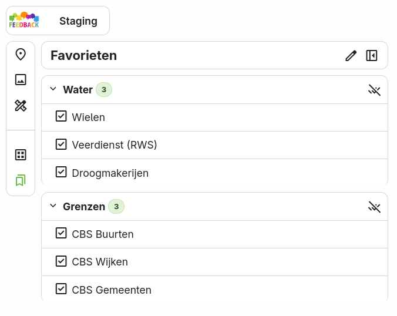
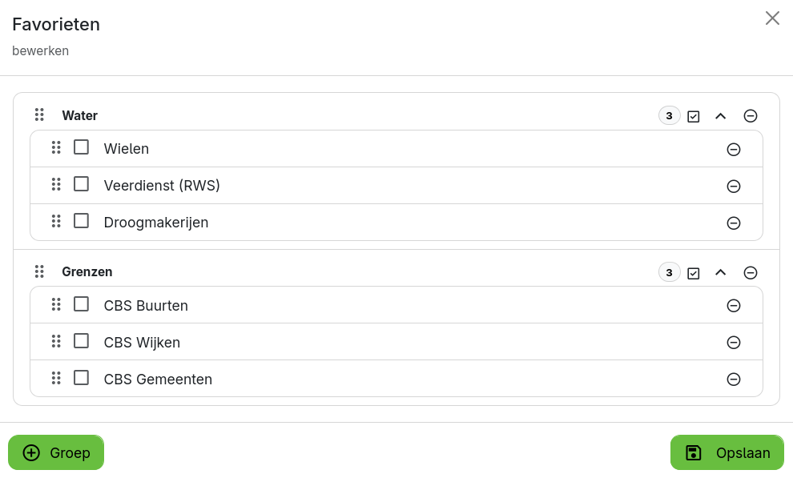

# Favorieten

Met de favorietenfunctie maak je specifieke kaartlagen eenvoudig toegankelijk door ze op te slaan als persoonlijke
favoriet. Je favoriete kaartlagen komen terecht in de tool **Favorieten** in de zijbalk. Daar roep je ze weer op en
deel je ze in eigen groepen in. Je favorieten worden in je eigen profiel opgeslagen, zodat ze
op elke computer en in elke browser beschikbaar zijn. Favorieten zijn alleen beschikbaar als je bent
[ingelogd](../index.md#inloggen).

## Een kaartlaag markeren als favoriet

1. Zoek een kaartlaag en voeg deze toe aan de kaart, bijvoorbeeld via het [zoekvenster](../search/index.md).
1. Open in de [legenda](../layers/index.md#knoppen-per-kaartlaag) het **contextmenu ⋮** van de kaartlaag.
1. Klik op **Aan favorieten toevoegen**. De kaartlaag staat nu in het paneel [Favorieten](#je-favorieten-gebruiken).

Wil je een kaartlaag niet langer als favoriet bewaren, kies dan in hetzelfde contextmenu **Uit favorieten**.

!!! tip "Favoriet met filter"
    Je kunt een kaartlaag als favoriet bewaren inclusief een bepaalde filtering. Pas eerst het
    [filter](../layers/filter.md) toe op de kaartlaag en markeer de kaartlaag vervolgens als favoriet.

## Je favorieten gebruiken

Klik in de zijbalk links op **Favorieten** om het favorietenpaneel te openen. Hier staan al je favoriete kaartlagen,
ingedeeld in groepen.

- Klik op een kaartlaag om deze aan de kaart toe te voegen. Klik nogmaals om de kaartlaag weer uit te zetten.
- Het getal achter de naam van een groep geeft aan hoeveel kaartlagen uit die groep op de kaart staan.
- Met de knop in de kop van een groep zet je alle kaartlagen in die groep in één keer aan (**Alles weergeven**) of uit
  (**Alles verbergen**).

## Favorieten beheren

Je beheert je favorieten zelf en deelt ze in groepen in. Klik in het favorietenpaneel op het **potlood** om het
venster **Favorieten bewerken** te openen.

1. Pas de naam van een groep aan door in de naam te klikken.
1. Sleep groepen en kaartlagen aan het handvat links naar de gewenste volgorde. Je kunt een kaartlaag ook naar een
   andere groep slepen.
1. Klik op **⊖** om een kaartlaag of groep uit je favorieten te verwijderen.
1. Klik op **+ Groep** om een nieuwe groep te maken.
1. Kies met de keuzeknop in de kop van een groep hoe de kaartlagen in die groep werken:
    - **Meerdere tegelijk** (vinkjes): elke klik voegt een kaartlaag toe, zodat je meerdere kaartlagen tegelijk toont.
    - **Eén tegelijk** (keuzerondjes): je wisselt tussen de kaartlagen binnen de groep. Dit is geschikt om snel te
      wisselen tussen kaartlagen die het hele gebied vullen.
1. Bepaal met het **pijltje** in de kop van een groep of de groep in het favorietenpaneel uitgeklapt of ingeklapt
   wordt getoond.
1. Klik op **Opslaan** om de wijzigingen te bewaren.

In dit venster geeft het getal in de kop van een groep aan hoeveel kaartlagen de groep in totaal bevat.

## Een favoriete ondergrond instellen

Naast kaartlagen kun je ook een ondergrond als favoriet instellen:

1. Open in de kop van de [legenda](../layers/index.md#de-kop-van-de-legenda) het **contextmenu ⋮**.
1. Kies onder **Ondergrond** de gewenste ondergrond.
1. Klik op het **bladwijzer-icoon** achter de actieve ondergrond.

Je favoriete ondergrond wordt in je eigen profiel bewaard. Zie ook [Ondergronden](../map/index.md#ondergronden).
