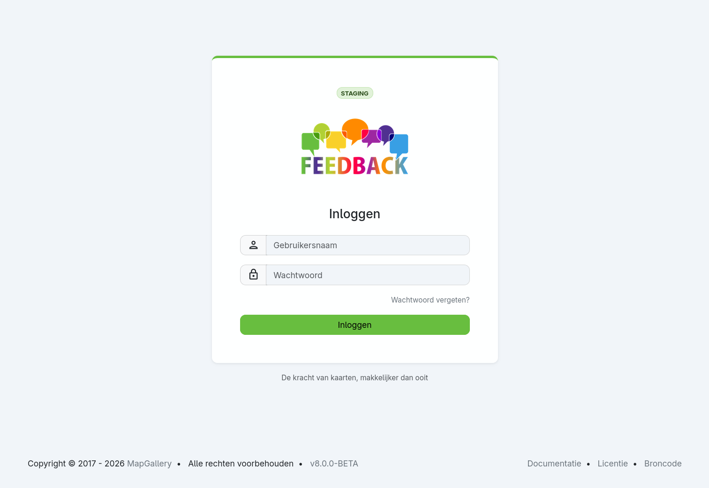
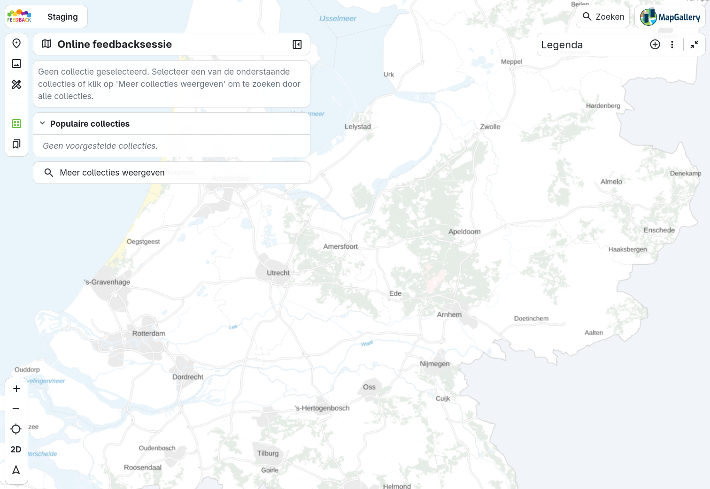
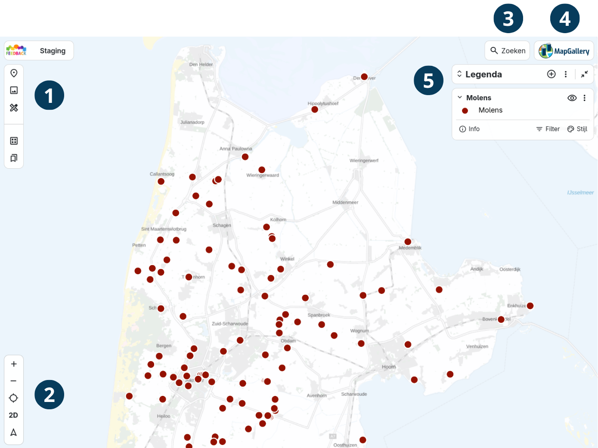

# Aan de slag met MapGallery

Deze documentatie beschrijft de verschillende onderdelen van de MapGallery-gebruikersomgeving en hoe je deze
effectief kunt gebruiken. Op deze pagina lees je hoe je inlogt en waar je de onderdelen in de applicatie vindt.

## Inloggen

### Uitnodiging

De beheerder van MapGallery binnen je organisatie bepaalt wie toegang krijgt. Zelf registreren is daarom niet
mogelijk. Heb je toegang gekregen, dan ontvang je een uitnodigingsmail met een link.

1. Klik op de link in de uitnodigingsmail.
1. Stel je eigen **wachtwoord** in.
1. Vul op het inlogscherm je **Gebruikersnaam** en **Wachtwoord** in en klik op **Inloggen**.

Sommige MapGallery-omgevingen zijn openbaar toegankelijk. In deze omgevingen kun je zonder in te loggen alle of
bepaalde kaartlagen bekijken, afhankelijk van de ingestelde toegangsrechten. Na het inloggen zie je ook de afgeschermde kaartlagen waartoe je toegang hebt.

!!! note "Automatisch inloggen"
    Afhankelijk van de instellingen van MapGallery binnen je organisatie word je automatisch ingelogd bij het openen
    van de applicatie.

### Wachtwoord vergeten

Klik op het inlogscherm op **Wachtwoord vergeten?** en volg de instructies in de e-mail die je ontvangt. Lukt dit
niet, neem dan contact op met de beheerder van MapGallery binnen je organisatie.

### Onderdelen na inloggen

Sommige onderdelen zijn alleen beschikbaar als je bent ingelogd:

| Onderdeel                                        | Beschikbaar voor          |
|--------------------------------------------------|---------------------------|
| Afgeschermde kaartlagen en collecties            | Alle ingelogde gebruikers, of alleen de leden van een bepaalde groep |
| [Favorieten](favorites/index.md) (kaartlagen en ondergrond), opgeslagen in je eigen profiel | Alle ingelogde gebruikers |
| [Recent bekeken collecties](collections/index.md#een-collectie-kiezen) | Alle ingelogde gebruikers |
| **Naar beheeromgeving**                          | Alleen beheerders         |

## De belangrijkste kenmerken

De basis van MapGallery is een [ondergrond](map/index.md#ondergronden), zoals een topografische kaart of een
luchtfoto. Over deze ondergrond worden interactieve [kaartlagen](layers/index.md) weergegeven. Een kaartlaag bevat
een visualisatie van specifieke geografische gegevens. Dit kan van alles zijn, bijvoorbeeld de locaties van
bluswatervoorzieningen of zorginstellingen, maar ook de actuele verkeersinformatie of een digitale weergave van het
aardoppervlak. Een [collectie](collections/index.md) bundelt kaartlagen rond een thema.

Daarnaast kun je in MapGallery:

- met het [zoekvenster](search/index.md) zoeken naar adressen, gegevens, kaartlagen, collecties, ondergronden en
  coördinaten;
- [informatie opvragen](location/index.md) over locaties en objecten, en [selecties maken](location/selection.md);
- kaartlagen [filteren](layers/filter.md) of een andere [stijl](layers/index.md#stijl) geven;
- afstanden en oppervlakten [meten](draw/index.md) en zelf op de kaart tekenen;
- een [eigen GIS-bestand](layers/import.md) direct op de kaart zetten;
- een eigen set [favoriete kaartlagen](favorites/index.md) bewaren en indelen in groepen die aansluiten op je
  projecten en werkzaamheden;
- [gegevens downloaden](export/index.md#gegevens-downloaden): een volledige kaartlaag, een selectie of alleen de
  gefilterde objecten;
- de kaart [delen](export/index.md#link-kopieren) via een link of als afbeelding.

## Het startscherm

Na het openen van MapGallery zie je direct de kaart. Is er nog geen collectie gekozen, dan opent links het
collectiepaneel met **Recent bekeken collecties**, **Populaire collecties** en de knop **Meer collecties weergeven**.
Zie [Collecties](collections/index.md).

## De interface

| Nr. | Onderdeel | Plaats | Meer informatie |
|-----|-----------|--------|-----------------|
| 1 | **Zijbalk** met de knoppen Info, Straatbeeld, Tekenen, Collectie en (na inloggen) Favorieten | Links | [Locatie informatie](location/index.md), [Straatbeelden](streetview/index.md), [Meten & Tekenen](draw/index.md), [Collecties](collections/index.md), [Favorieten](favorites/index.md) |
| 2 | **Kaartbediening**: zoomen, Mijn locatie, 2D/3D en Rotatie | Linksonder | [De kaart](map/index.md) |
| 3 | **Zoeken** | Rechtsboven | [Zoeken](search/index.md) |
| 4 | **Hoofdmenu** (MapGallery-logo), met daarnaast de knop **Aanmelden** als je niet bent ingelogd | Rechtsboven | [Hoofdmenu & instellingen](menu/index.md) |
| 5 | **Legenda** van de actieve kaartlagen, met de knoppen om kaartlagen toe te voegen en de ondergrond te kiezen | Rechtsboven | [Kaartlagen & legenda](layers/index.md) |

Let op het verschil tussen de twee logo's: het **MapGallery-logo** rechtsboven opent het hoofdmenu, het **logo met de
naam van je omgeving** linksboven brengt je terug naar de standaardcollectie.

