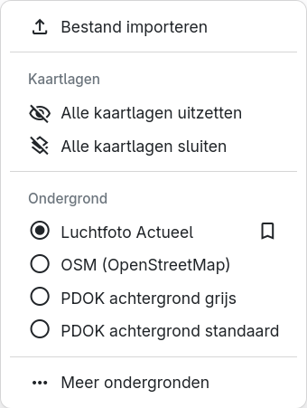
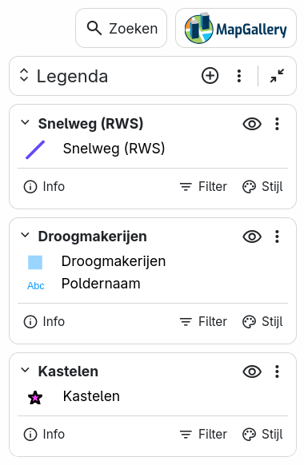
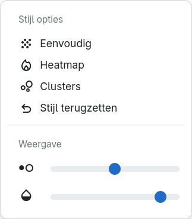

# Kaartlagen & legenda

Een kaartlaag is een informatielaag met geografische gegevens die je onafhankelijk van andere kaartlagen aan- en
uitzet. De **legenda** rechtsboven in het scherm toont de actieve kaartlagen. Vanuit de legenda voeg je kaartlagen
toe, kies je de ondergrond en heb je volledige controle over de actieve kaartlagen.

## De kop van de legenda

In de kop van de legenda staan de knoppen die voor alle kaartlagen gelden:

| Knop | Functie |
|------|---------|
| **Pijltje** (links) | De blokken van alle kaartlagen in- of uitklappen. |
| **⊕** (Kaartlaag toevoegen) | Het [zoekvenster](../search/index.md) openen op het tabblad Kaartlagen. |
| **Contextmenu ⋮** | Het menu met de legenda-opties openen. Zie [Legenda-opties](#legenda-opties). |
| **Legenda verbergen** (rechts) | De legenda inklappen, zonder dat de kaartlagen worden gesloten. Klik nogmaals om de legenda weer te tonen. |

### Legenda-opties

Open het **contextmenu ⋮** in de kop van de legenda voor de volgende opties:

| Optie | Functie |
|-------|---------|
| **Bestand importeren** | Een eigen bestand tijdelijk op de kaart zetten. Zie [Eigen bestanden](import.md). |
| **Alle kaartlagen uitzetten** | Alle actieve kaartlagen in één keer verbergen. Ze blijven in de legenda staan. |
| **Alle kaartlagen sluiten** | Alle kaartlagen uit de legenda en van de kaart verwijderen. |
| Ondergrond | De actieve ondergrond wijzigen, of via **Meer ondergronden** een andere ondergrond kiezen. Zie [Ondergronden](../map/index.md#ondergronden). |

**Alle kaartlagen uitzetten** en **Alle kaartlagen sluiten** zie je alleen als er kaartlagen actief zijn.

## Kaartlagen in de legenda

Elke actieve kaartlaag wordt in de legenda weergegeven in een eigen blok, met specifieke opties voor weergave en
interactie.

- Klik op het **pijltje** voor de naam om een kaartlaag in of uit te klappen.
- **Sleep** een kaartlaag om de volgorde van de kaartlagen aan te passen.
- De kleuren en symbolen geven de categorieën binnen de kaartlaag weer. Klik op een **legenda-item** om die categorie
  aan of uit te zetten. Op dezelfde manier zet je labels aan of uit.

### Knoppen per kaartlaag

In de kop en onder in elk blok staan de knoppen voor die kaartlaag:

| Knop | Plaats | Functie |
|------|--------|---------|
| **Zichtbaarheid** (oog) | Kop | De kaartlaag tijdelijk verbergen zonder deze te sluiten. |
| **Contextmenu ⋮** | Kop | Meer opties: **Aan favorieten toevoegen**, **Zoom naar kaartlaag**, **Gegevens herladen** en **Kaartlaag sluiten**. |
| **Info** | Onder | De [metadata](metadata.md) van de kaartlaag bekijken. |
| **Filter** | Onder | Alleen de objecten tonen die aan bepaalde voorwaarden voldoen. Zie [Filteren](filter.md). Is er een filter actief, dan is de knop gekleurd en toont deze het aantal filterregels. |
| **Stijl** (palet) | Onder | De weergave van de kaartlaag aanpassen. Zie [Stijl](#stijl). |

- **Zoom naar kaartlaag** zoomt in op het volledige gebied van de kaartlaag. Is er een filter actief, dan zoomt de
  kaart in op het gebied van de gefilterde objecten.
- **Gegevens herladen** laadt de gegevens van de kaartlaag opnieuw.
- **Kaartlaag sluiten** verwijdert de kaartlaag uit de legenda en van de kaart.
- **Aan favorieten toevoegen** markeert de kaartlaag als [favoriet](../favorites/index.md), zodat je snel naar deze kaartlaag
  terugkeert zonder de volledige lijst van kaartlagen te doorzoeken. Is de kaartlaag al een favoriet, dan staat hier
  **Uit favorieten**. Deze optie is alleen beschikbaar als je bent ingelogd.

## Stijl

Bij een vectorkaartlaag pas je met de knop **Stijl** de weergave aan. Welke opties beschikbaar zijn, hangt af van het
type kaartlaag.

| Optie | Functie | Beschikbaar voor |
|-------|---------|------------------|
| **Eenvoudig** | De standaardweergave van de kaartlaag, zonder speciale effecten of aanpassingen. | Alle vectorkaartlagen |
| **Heatmap** | Gegevens weergeven op basis van dichtheid: hoe meer objecten in een gebied, hoe intenser de kleur. Geschikt om concentraties in grote datasets zichtbaar te maken. | Alle vectorkaartlagen |
| **Clusters** | Dicht bij elkaar liggende punten groeperen tot clusters, afhankelijk van het zoomniveau. Zo blijft de kaart overzichtelijk bij veel punten. | Vectorpuntlagen |
| **Stijl terugzetten** | Alle aangepaste stijlinstellingen terugzetten naar de oorspronkelijke weergave. | Alle vectorkaartlagen |
| Grootte (schuifregelaar) | De grootte van de symbolen aanpassen. | Vectorpuntlagen |
| Transparantie (schuifregelaar) | De transparantie van de kaartlaag aanpassen. | Alle vectorkaartlagen |