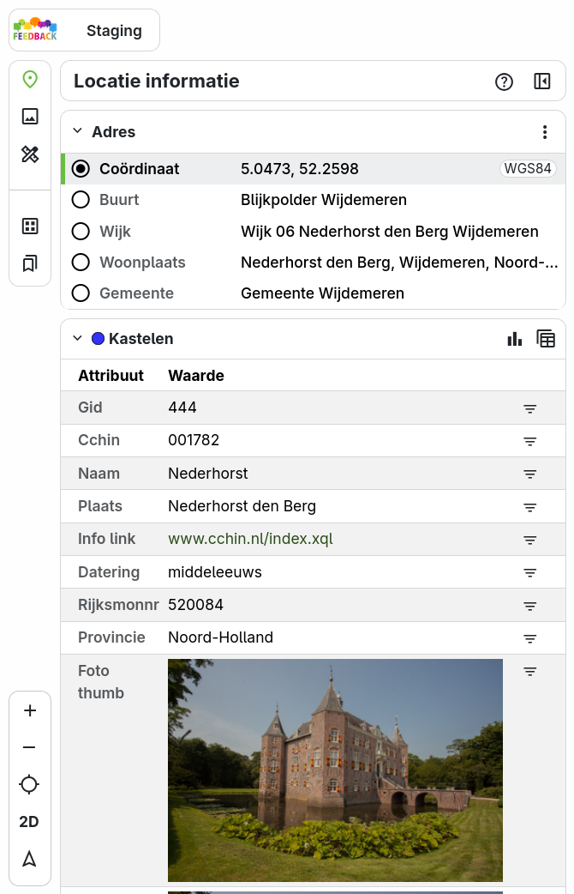

# Locatie informatie

Wanneer je op een locatie op de kaart klikt, verschijnt links het paneel **Locatie informatie**. Hier krijg je
gedetailleerde informatie over de geselecteerde locatie en over de objecten van de actieve kaartlagen op die plek.
Elk blok in het paneel is inklapbaar.

Je opent het paneel ook met de knop **Info** in de zijbalk.

!!! note
    Een marker geeft de geselecteerde locatie op de kaart weer. Klik op een andere locatie op de kaart of versleep de
    marker naar een nieuwe locatie om andere informatie op te vragen.

## Adres

Het blok **Adres** toont de gegevens van de geselecteerde locatie:

| Regel | Inhoud |
|-------|--------|
| **Coördinaat** | Het coördinaat van de locatie, met het coördinatenstelsel erachter, bijvoorbeeld WGS84. |
| **Adres** of **Weg** | Het dichtstbijzijnde adres of de dichtstbijzijnde weg, als die beschikbaar is. |
| **Buurt**, **Wijk**, **Woonplaats** en **Gemeente** | De gebieden waarin de locatie ligt. |

Klik op het keuzerondje voor een buurt, wijk, woonplaats of gemeente om dat gebied op de kaart weer te geven en alle
objecten te selecteren die volledig binnen het gebied liggen. Zie [Selecteren](selection.md).

Via het **contextmenu ⋮** in de kop van het blok:

- **Coördinatenstelsel**: kies in de keuzelijst tussen WGS84 (EPSG:4326), Web Mercator (EPSG:3857) en
  Rijksdriehoekstelsel (EPSG:28992).
- **Huidige geometrie toevoegen aan tekening**: voeg de geselecteerde locatie of het geselecteerde gebied toe aan
  [Meten & Tekenen](../draw/index.md).

## Attribuutgegevens

Onder het adres staat per kaartlaag een blok met de attribuutgegevens van het geselecteerde object, in een tabel met
**Attribuut** en **Waarde**. Links en afbeeldingen in de gegevens zijn klikbaar.

- Zijn er meerdere objecten geselecteerd, dan blader je er met de pijltjes doorheen, bijvoorbeeld **1 / 3**.
- Met het **filtericoon** achter een attribuut maak je direct een [filter](../layers/filter.md) op die waarde.

In de kop van elk blok staan de volgende knoppen:

| Knop | Functie |
|------|---------|
| **Toevoegen aan tekening** | De geometrie van het object overnemen in [Meten & Tekenen](../draw/index.md). Deze knop is niet bij elke selectie beschikbaar. |
| **Statistieken tonen** | Statistieken over de geselecteerde objecten bekijken. Zie [Statistieken](selection.md#statistieken). |
| **Tabel** | Alle geselecteerde objecten in een tabel bekijken. Zie [Tabel](selection.md#tabel). |

## Straatbeeld en luchtfoto's

Afhankelijk van de instellingen van de beheerder staan in het paneel ook knoppen om een straatbeeld of schuine
luchtfoto's (oblique foto's) van de locatie te bekijken, bijvoorbeeld via Google Street View of Kavel10. Klik op het
icoon om de weergave in een nieuw venster te openen. Zie ook [Straatbeelden](../streetview/index.md).

## Tips en hints

Met de knop **?** in de kop van het paneel zet je tips en hints aan of uit. Deze geven aanvullende uitleg bij de
onderdelen van het paneel.
