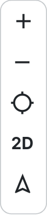

# De kaart

Het centrale gedeelte van de interface is de kaart. Hier zoom je in en uit en verplaats je de kaart om verschillende
geografische gebieden te verkennen. De kaart toont de actieve kaartlagen op de gekozen ondergrond. Je bedient de kaart
met de muis, het toetsenbord, een touchscreen of de knoppen linksonder.

## Knoppen linksonder

| Knop | Functie |
|------|---------|
| **+** en **−** | In- en uitzoomen op de kaart. |
| **Mijn locatie** | Je huidige locatie op de kaart weergeven. Je browser vraagt hiervoor eerst toestemming. |
| **Weergave** (2D/3D) | Wisselen tussen de 2D-weergave en de 3D-weergave, voor een gedetailleerder perspectief van het terrein. |
| **Rotatie** (noordpijl) | De kaart een halve slag (180°) draaien. Klik nogmaals om het noorden weer boven te zetten. |

## Muisbediening

De kaart is volledig te bedienen met de muis.

| Actie | Muisbediening |
|-------|---------------|
| Kaart verplaatsen | Houd de **linkermuisknop** ingedrukt en sleep de kaart. |
| Zoomen | Draai aan het **muiswiel**, of dubbelklik om in te zoomen. |
| Kaart draaien | Houd de **rechtermuisknop** ingedrukt en sleep horizontaal. |
| Wisselen tussen 2D en 3D | Houd de **rechtermuisknop** ingedrukt en sleep verticaal. |
| Informatie opvragen | Klik op een locatie of object. Zie [Locatie informatie](../location/index.md). |

!!! note "Shift + slepen"
    Als je ++shift++ ingedrukt houdt en sleept, maak je een selectie met een rechthoek. Zie
    [Selecteren](../location/selection.md).

## Toetsenbordbediening

Je kunt de kaart ook bedienen met sneltoetsen. Klik eerst op de kaart, zodat de kaart de toetsaanslagen ontvangt.

| Actie | Toetsen |
|-------|---------|
| Kaart verplaatsen | ++arrow-left++ ++arrow-up++ ++arrow-right++ ++arrow-down++ |
| In- en uitzoomen | ++plus++ en ++minus++ |
| Kaart draaien | ++shift+arrow-left++ en ++shift+arrow-right++ |
| Wisselen tussen 2D en 3D | ++shift+arrow-up++ en ++shift+arrow-down++ |

## Bediening op een touchscreen

Op een telefoon of tablet kun je de kaart bedienen met aanrakingen en bewegingen.

| Actie | Gebaar |
|-------|--------|
| Kaart verplaatsen | Sleep met één vinger. |
| Zoomen | Knijp of spreid met twee vingers. |
| Kaart draaien | Draai met twee vingers. |
| Wisselen tussen 2D en 3D | Sleep met twee vingers omhoog of omlaag. |

## Ondergronden

Door een ondergrond te kiezen, bepaal je de basisweergave van de kaart waarop de kaartlagen worden weergegeven. Je
kunt de ondergrond op elk moment aanpassen aan je behoeften en analyses.

1. Open in de kop van de [legenda](../layers/index.md#de-kop-van-de-legenda) het **contextmenu ⋮**.
1. Onder **Ondergrond** staan de ondergronden die de beheerder als standaardondergrond heeft aangemerkt. De actieve
   ondergrond is gemarkeerd met een bolletje.
1. Klik op een andere ondergrond in de lijst om de actieve ondergrond te wisselen.

Ben je ingelogd, dan stel je de actieve ondergrond in als **favoriete ondergrond** met het **bladwijzer-icoon** achter
de ondergrond. Je favoriete ondergrond wordt in je eigen profiel bewaard. Zie ook [Favorieten](../favorites/index.md).

Staat de gewenste ondergrond niet in de lijst, klik dan op **Meer ondergronden**. Het
[zoekvenster](../search/index.md) opent op het tabblad **Ondergrond**, met een overzicht van alle beschikbare
ondergronden.

!!! note
    Een [collectie](../collections/index.md) kan een eigen ondergrond hebben. Als je een collectie opent, wisselt de
    ondergrond automatisch mee.

## De kaartweergave delen

De positie, het zoomniveau, de rotatie, de kanteling en de actieve kaartlagen worden bijgehouden in de link in de
adresbalk. Hoe je de kaartweergave deelt, lees je in [Downloaden & delen](../export/index.md#link-kopieren).
